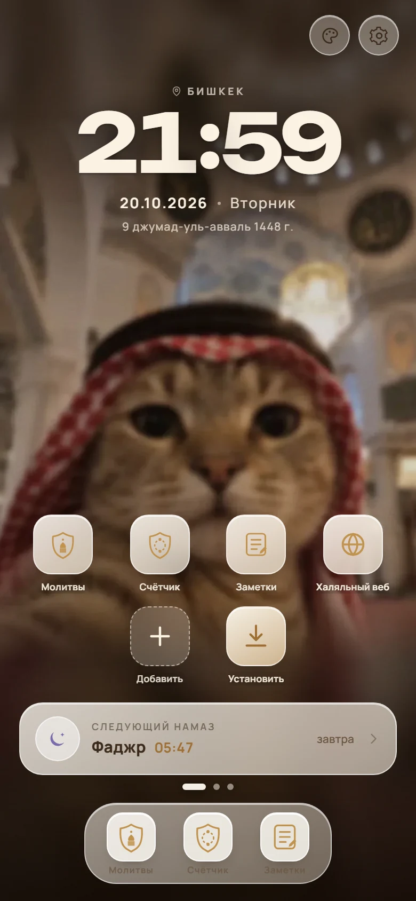
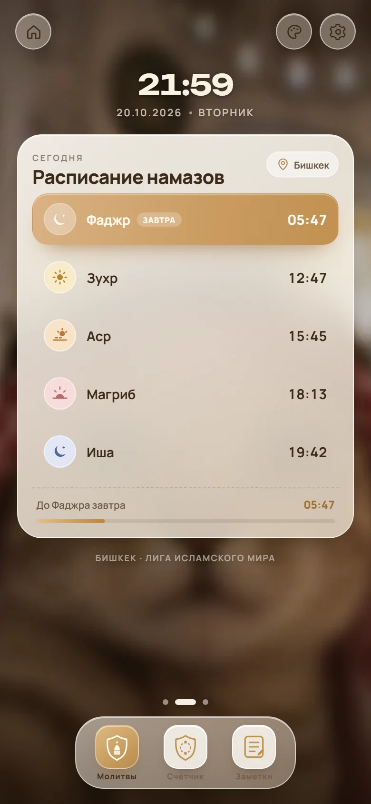
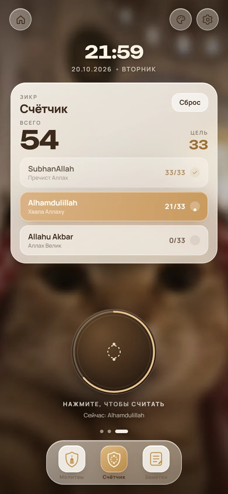
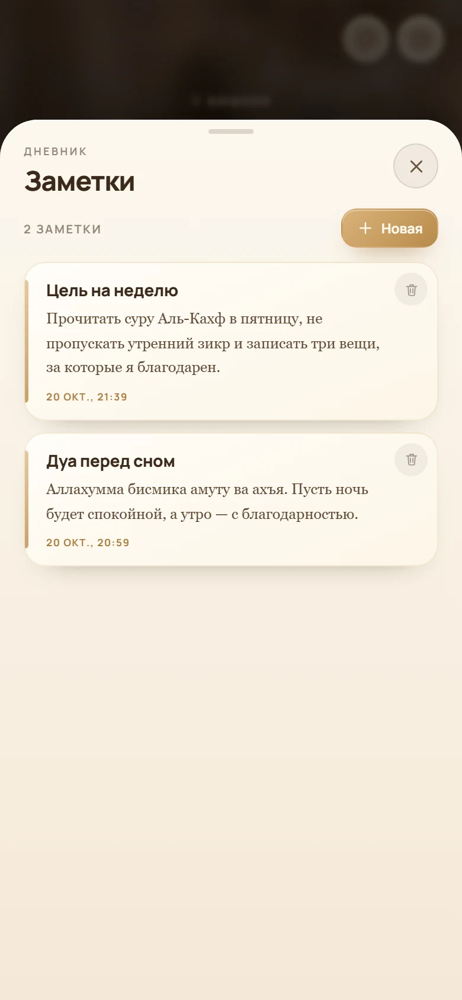
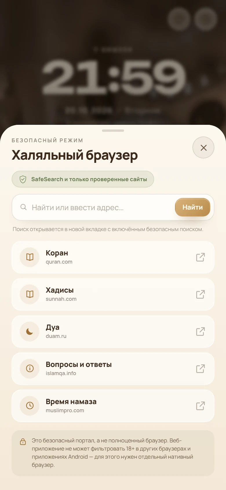
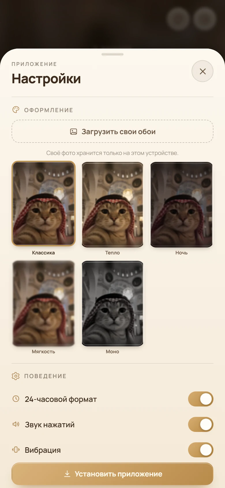
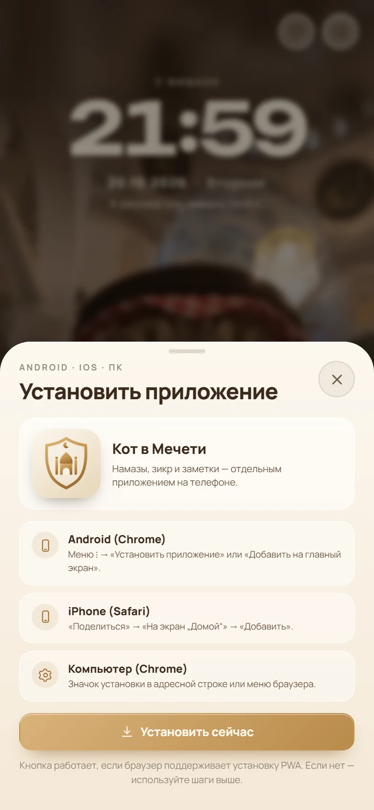
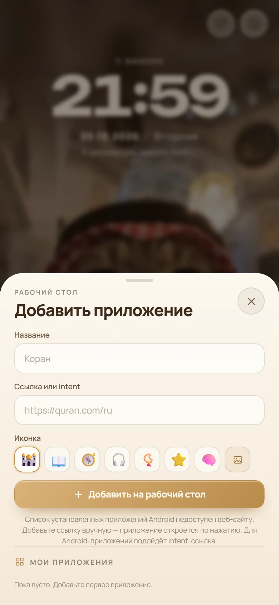
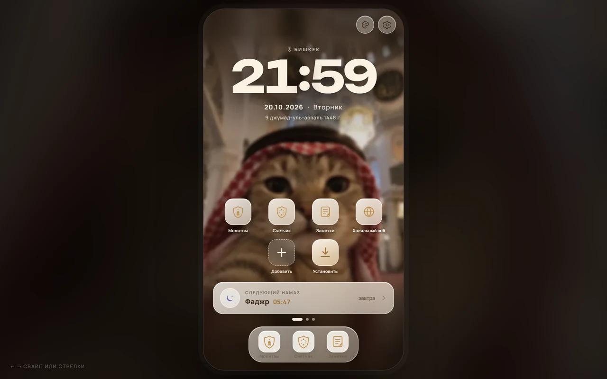

# Исламский помощник — «Кот в Мечети» 1.1

Мобильное веб-приложение (PWA) с рабочим столом, расписанием намазов, счётчиком зикра,
заметками и безопасным халяльным веб-порталом. Без сборки, фреймворков и сервера:
открывается сразу, работает офлайн, устанавливается на Android, iPhone и компьютер.

| Рабочий стол | Расписание | Счётчик |
| --- | --- | --- |
|  |  |  |

| Заметки | Халяльный веб | Настройки |
| --- | --- | --- |
|  |  |  |

| Установка | Добавить приложение | Компьютер |
| --- | --- | --- |
|  |  |  |

## Быстрый старт

**Сразу на компьютере:** двойной клик по [index.html](index.html) или [start.bat](start.bat).
Всё лежит в папке, шрифты встроены, интернет не нужен.

**Сразу на телефоне (та же Wi-Fi):**

```bat
serve.bat
```

Скрипт запускает локальный сервер на `8080` и открывает сайт в браузере. На телефоне
введите `http://IP-компьютера:8080` (IP смотрится в `ipconfig`). Разрешите Python
в брандмауэре Windows. Через `localhost` PWA устанавливается, а на телефоне по IP —
работает сайт; для установки PWA с телефона нужен HTTPS-хостинг (GitHub Pages подойдёт).

**Публикация на GitHub Pages** — см. [ниже](#публикация-на-github-pages).

## Что нового в 1.1

- **Рабочий стол на главном экране:** часы, дата, следующий намаз и сетка приложений —
  «Молитвы», «Счётчик», «Заметки», «Халяльный веб», «Добавить», «Установить».
- **Свои приложения:** добавьте название, ссылку или Android `intent`, эмодзи или
  загрузите иконку с телефона. Ссылка открывается по нажатию, всё хранится локально.
- **Установка на Android/iPhone:** отдельная шторка с шагами и кнопкой установки.
- **Халяльный веб:** безопасный поиск с `SafeSearch`, проверенные исламские сайты
  и блокировка взрослых запросов/доменов.
- **Свои обои:** загрузите любое фото с устройства — оно сожмётся, сохранится локально
  и применится к приложению. Быстрая кнопка «палитра» вверху открывает выбор обоев.
- **Заметки красивее:** бумажные карточки, золотая полоса, засечный шрифт для текста,
  аккуратные даты и редактор.
- Версия 1.1, обновлённый офлайн-кэш.

## Рабочий стол и приложения

Главный экран — это «рабочий стол» приложения: часы, дата по Хиджре, следующий намаз
и плитки. Свайп влево/вправо переключает «Рабочий стол → Расписание → Счётчик».

- **Добавить** — шторка «Добавить приложение»: имя, ссылка (`https://…` или
  `intent://…`), иконка (эмодзи или фото). До 12 приложений.
- **Мои приложения** — список с удалением и отменой удаления.
- **Установить** — установка PWA или инструкция для Android/iPhone/ПК.
- Плитки «Молитвы», «Счётчик», «Заметки», «Халяльный веб» ведут в соответствующие разделы.
- Настройки — шестерёнка; обои — палитра рядом с ней.

### Честно о «приложениях из устройства»

Веб-приложение **не может получить список установленных приложений Android** и не может
их устанавливать — это ограничение браузера, а не сайта. Можно добавить ярлык на любое
приложение через `intent`-ссылку (например, `intent://...#Intent;package=com.whatsapp;end`)
или на сайт. Ярлыки хранятся только на устройстве.

## Установка на Android и iPhone

1. Откройте сайт в Chrome (Android) или Safari (iPhone).
2. Android: меню ⋮ → **«Установить приложение»** (или «Добавить на главный экран»).
   iPhone: **«Поделиться» → «На экран „Домой“» → «Добавить»**.
3. Запускайте приложение с иконки на главном экране — оно откроется без адресной строки.

В приложении есть кнопка/плитка «Установить» с подсказками для каждой платформы.
Для установки нужен HTTPS или `localhost`; по локальному IP без HTTPS браузер может
не показать установку.

### Важное ограничение: системный рабочий стол

Сайт/PWA **не может заменить системный рабочий стол Android** (кнопку «Домой») — для
этого нужен нативный APK-лаунчер с `category.HOME` и доступом к списку приложений.
«Рабочий стол» в этом приложении — это рабочий стол **внутри приложения**, а иконка
на домашнем экране — максимум, что может веб-приложение. Полноценный лаунчер/браузер
делается отдельным нативным Android-приложением (Kotlin + WebView), его сборка требует
Android Studio и подписи.

## Халяльный веб

Раздел «Халяльный веб» — это безопасный портал, а не системный фильтр:

- поиск открывается в новой вкладке DuckDuckGo с принудительным `SafeSearch` (`kp=1`);
- блокируются явные взрослые домены и слова (porn, xxx, adult, nude, erotic, escort,
  hentai, onlyfans и т. п.);
- есть только проверенные ссылки: quran.com, sunnah.com, duam.ru, islamqa.info,
  muslimpro.com;
- при попытке ввести заблокированный адрес/запрос показывается ошибка.

**Ограничение:** веб-приложение не может фильтровать 18+ в других браузерах и
приложениях Android. Для полной фильтрации нужен отдельный нативный браузер с
WebView-фильтром, DNS-фильтр или родительский контроль на уровне системы. Блоклист
на клиенте можно обойти, он не является гарантией безопасности.

## Заметки

- Создание, редактирование, удаление и отмена удаления.
- «Бумажные» карточки с золотой полосой и засечным шрифтом для текста.
- Всё хранится в `localStorage`, без облака и регистрации; работает офлайн.

## Обои

- 5 готовых вариантов: «Классика», «Тепло», «Ночь», «Мягкость», «Моно».
- **«Загрузить свои обои»** — фото с устройства, сжимается до 900×1600, хранится
  локально; для размытых экранов автоматически делается мягкая версия.
- Кнопка-палитра в верхней панели открывает выбор обоев в настройках.
- «Убрать» удаляет пользовательское фото и возвращает «Классику».

## Намазы

Время считается астрономически **на устройстве** (без API и сети): положение Солнца,
уравнение времени, часовые углы. По умолчанию — Бишкек, Лига исламского мира
(Фаджр 18°, Иша 17°), шафиитский Аср.

- Города: Бишкек, Ош, Каракол, Алматы, Ташкент, Душанбе, Москва, Казань, Стамбул,
  Мекка, Дубай, Лондон, Париж, Нью-Йорк.
- Методы: MWL, ISNA, Египетское управление, Карачи, Умм аль-Кура, Диянет.
- Мазхабы: шафиитский и ханафитский (время Асра).
- Геолокация по кнопке (HTTPS/localhost).

Время может отличаться от расписания конкретной мечети на 1–2 минуты — выберите
подходящий метод.

## Публикация на GitHub Pages

В проекте уже лежит GitHub Actions workflow
[.github/workflows/pages.yml](.github/workflows/pages.yml), который публикует папку
на GitHub Pages при пуше в `main`.

1. Создайте **публичный** репозиторий, например `islamic-helper`.
2. Загрузите проект:

```bash
git init
git add .
git commit -m "Islamic helper PWA"
git branch -M main
git remote add origin https://github.com/ВАШ-ЛОГИН/islamic-helper.git
git push -u origin main
```

Без командной строки: **GitHub Desktop** → Add local repository → Publish repository.

3. В репозитории: **Settings → Pages → Build and deployment → Source: GitHub Actions**.
   Workflow `Deploy to GitHub Pages` соберёт и опубликует сайт.
   Альтернатива без workflow: Source → **Deploy from a branch** → `main` / `(root)`.
4. Ссылка будет вида:

```
https://ВАШ-ЛОГИН.github.io/islamic-helper/
```

Она работает как обычный сайт и как PWA (HTTPS уже есть). На телефоне откройте ссылку
и установите приложение.

> В среде, где готовился проект, не было доступа к GitHub-аккаунту (ни `git`, ни
> `gh`, ни токена), поэтому пуш не выполнялся. Репозиторий и workflow готовы; нужен
> только ваш логин/репозиторий.

## Структура

```
index.html                    разметка, SVG-иконки, шторки
styles.css                    дизайн, адаптив, анимации
app.js                        логика: время, намазы, свайпы, счётчик, заметки,
                              рабочий стол, приложения, халяльный веб, обои
manifest.webmanifest          PWA-манифест
sw.js                         офлайн-кэш (v1.1.0)
start.bat                     открыть сайт двойным кликом
serve.bat                     локальный сервер (Python) для установки PWA
assets/
  fonts/fonts.css             Manrope + Unbounded, встроены как data URI
  icons/                      иконки приложения, favicon, apple-touch-icon
  img/                        обои (резкие и размытые)
design/
  mockups/                    исходные макеты
  screens/                    финальные скриншоты
.github/workflows/pages.yml   деплой на GitHub Pages
```

## Проверено

- Три экрана, свайпы, клавиатура, колесо трекпада, кнопка «Домой».
- Рабочий стол: плитки, добавление/удаление приложения, ссылка и эмодзи, сохранение.
- Установка: плитка/шторка, шаги Android/iPhone/ПК, фолбэк при недоступном prompt.
- Халяльный веб: 5 проверенных ссылок, блокировка запроса `porn`, SafeSearch-ссылка.
- Обои: 5 пресетов + загрузка своего фото, сохранение, размытая версия, удаление.
- Заметки: создание, сохранение, удаление, отмена, засечный шрифт.
- Намазы сверены с aladhan.com (Бишкек, 20.10.2026, MWL) — в пределах минуты.
- Адаптив: 390×844, 375×667, 320×568, 1280×800.
- Офлайн через service worker и запуск `index.html` с диска (`file://`).
- Консоль без ошибок; манифест проходит `getInstallabilityErrors`.

## Приватность

Приложение не отправляет данные на сервер. Настройки, счётчик, заметки, приложения и
свои обои остаются в `localStorage`. Геолокация запрашивается только по кнопке.
Внешние ссылки открываются в новой вкладке только по нажатию. Удалить всё —
«Настройки» → «Сбросить все данные».

## Ограничения проекта

- Это **PWA**, а не нативный APK: системный лаунчер, список установленных приложений
  и фильтрация трафика других приложений недоступны по определению.
- Для настоящего лаунчера/халяльного браузера нужен отдельный Android-проект
  (Kotlin/Java + WebView/PackageManager), подпись APK и доступ к Play Console или
  установка APK вручную.
- Блоклист 18+ на клиенте — вспомогательный, не гарантия. Не заменяет родительский
  контроль, DNS-фильтр или нативное приложение.
